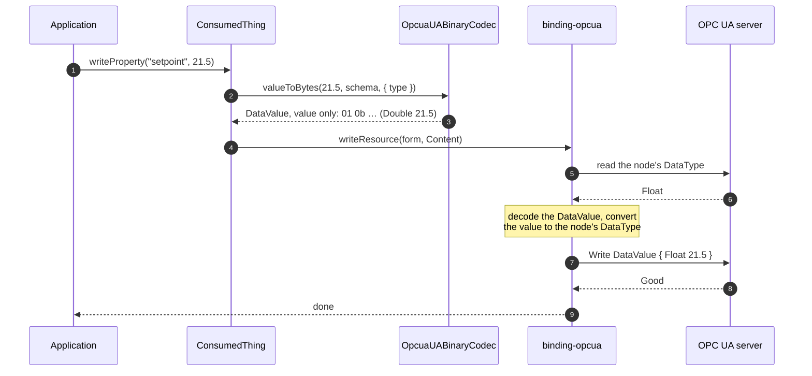

# Content negotiation

How a `contentType` on an OPC UA form decides what crosses the wire and what a WoT application
receives. Background: issue #1400, and the decision in [decisions.md](decisions.md) (D8).

## What each contentType means

An `opc.tcp` form takes one media type, `application/opcua+uabinary` (OPC 10000-6 Table 80, planned
for WoT OPC UA Binding 1.1). The payload is always the OPC UA Binary DataValue the server sent; the
`type` parameter picks what `value()` returns, as OPC UA JSON:

| contentType                                 | what `value()` returns                                      | notes                                                                          |
| ------------------------------------------- | ----------------------------------------------------------- | ------------------------------------------------------------------------------ |
| `application/opcua+uabinary`                | the bare value: `42.5`, `"hello"`, `[1,2,3]`                | `type=Value`, the default; OPC UA JSON 1.04 NonReversible (Annex H)            |
| `application/opcua+uabinary;type=Variant`   | value and OPC UA type: `{"UaType":11,"Value":42.5}`         | OPC UA JSON 1.05 Compact; see [opcua-json-encoding.md](opcua-json-encoding.md) |
| `application/opcua+uabinary;type=DataValue` | value, type, `Status`, `SourceTimestamp`, `ServerTimestamp` | OPC UA JSON 1.05 Compact                                                       |

`arrayBuffer()` returns the UA Binary DataValue whatever the view.

Every other contentType is refused with an error naming its replacement:

| contentType                      | replaced by                                     |
| -------------------------------- | ----------------------------------------------- |
| omitted, i.e. `application/json` | `application/opcua+uabinary`                    |
| `application/json`               | `application/opcua+uabinary`                    |
| `application/octet-stream`       | `application/opcua+uabinary` (Binding 1.0 name) |
| `application/opcua+json;type=X`  | `application/opcua+uabinary;type=X`             |
| `application/opcua+octet-stream` | `application/opcua+uabinary;type=DataValue`     |

A form without `contentType` is refused rather than read as `application/opcua+uabinary`: W3C WoT
TD 1.1 §5.3.4.2 makes it `application/json`, and a binding may not redefine that default.

## Payloads by example

What `value()` returns in each view. A write takes the same shape: the Value view takes the bare
value and the binding takes the type from the server; the Variant and DataValue views take the
OPC UA JSON shown.

**A ByteString** holding `DE AD BE EF`:

| view        | `value()`                                              |
| ----------- | ------------------------------------------------------ |
| `Value`     | `"3q2+7w=="`                                           |
| `Variant`   | `{"UaType":15,"Value":"3q2+7w=="}`                     |
| `DataValue` | `{"UaType":15,"Value":"3q2+7w==","SourceTimestamp":…}` |

The payload of all three is the DataValue `05 0f 04 00 00 00 de ad be ef` + SourceTimestamp.

**An array of ByteStrings**, `[01 02]` and `[03]`:

| view      | `value()`                               |
| --------- | --------------------------------------- |
| `Value`   | `["AQI=","Aw=="]`                       |
| `Variant` | `{"UaType":15,"Value":["AQI=","Aw=="]}` |

**An ExtensionObject** (an `Argument` structure):

| view      | `value()`                                                               |
| --------- | ----------------------------------------------------------------------- |
| `Value`   | `{"Name":"Arg1","DataType":{"Id":6},"ValueRank":-1,…}`: the fields only |
| `Variant` | `{"UaType":22,"Value":{"UaTypeId":"i=296","Name":"Arg1",…}}`            |

Note what the structure's identity costs: the Value view has no `UaTypeId`, so a consumer cannot
tell which structure it holds, nor two choices of a Union that hold the same value. The Variant
view keeps both. Writing a structure is refused for now, in every view (issue #1583).

## Where each conversion happens

The binding owns the OPC UA side of both directions. Core owns the media-type side: it decodes
what a read returned, and encodes what a write sends, with the binding's codec for
`application/opcua+uabinary`. The media type belongs to OPC UA alone, so the codec is registered
like any other, without a URI scheme:

```ts
// src/factory.ts
contentSerdes.addCodec(new OpcuaUABinaryCodec());
```

The codec runs in core, without a session. It encodes values of built-in types, and hands anything
else to the binding as JSON: a structure, an action input, and a Variant or DataValue view, whose
NodeIds need the session's namespace table. For a structure from a companion specification, whose
UA Binary body only the server's DataTypeDefinition decodes, the binding adds `;uaconn=<id>` to the
Content type, never to the form, and the codec decodes with the definitions of that session.

## Read

The server supplies the type; the TD does not have to.

```mermaid
sequenceDiagram
    autonumber
    participant App as Application
    participant CT as ConsumedThing
    participant B as binding-opcua
    participant Srv as OPC UA server
    participant IO as InteractionOutput
    participant UB as OpcuaUABinaryCodec
    App->>CT: readProperty("temperature")
    CT->>B: readResource(form)
    B->>Srv: Read
    Srv-->>B: DataValue { Double 42.5, SourceTimestamp }
    Note over B: resolveContentFormat(form.contentType)<br/>the DataValue in UA Binary
    B-->>CT: Content("application/opcua+uabinary;uaconn=…", bytes)
    CT-->>App: InteractionOutput
    App->>IO: value()
    IO->>UB: bytesToValue(bytes, schema, { type, uaconn })
    UB-->>IO: 42.5, or the Variant, or the DataValue
    Note over IO: validated against the TD schema
    IO-->>App: 42.5
    Note over App: arrayBuffer() returns the DataValue,<br/>Status and timestamps included
```

## Write

The binding asks the server for the node's DataType before building the Variant, so a TD that
says `"number"` still writes an Int32 to an Int32 node and an Int64 to an Int64 node.



## What each OPC UA type does

`test/contenttype-shapes-test.ts` reads 34 shapes in each view and asserts that every view gives
every shape, that the Variant view names its OPC UA type, and that the payload is the DataValue in
all three. `test/contenttype-write-test.ts` writes Double, Int32, Int64, String, Boolean and
ByteString back through the Value view, and Double and Int32 through the Variant and DataValue
views.

The table below was measured by reading a value, writing it back and comparing what the server
holds. Its Variant / DataValue column was measured with `application/opcua+json`, whose JSON
decoders the two views use. Its bare-value column was measured with `application/json`: the Value
view decodes structures and action inputs the same way, but writes a value of built-in type as OPC
UA Binary, so its rows for built-in types other than the six above are not re-measured.

| OPC UA value                                                | `Value` read                       | write back, bare value                     | write back, `Variant` / `DataValue` |
| ----------------------------------------------------------- | ---------------------------------- | ------------------------------------------ | ----------------------------------- |
| Double, Int32, Float, Byte, Boolean, String, Guid, DateTime | the plain value                    | ✔                                         | ✔                                  |
| Int64, UInt64                                               | a string, as JSON cannot hold 2^53 | ✔                                         | ✔                                  |
| Enumeration                                                 | the number                         | ✔                                         | ✔                                  |
| ByteString                                                  | base64                             | ✔                                         | ✔                                  |
| arrays of the above                                         | a JSON array                       | ✔                                         | ✔                                  |
| ByteString[]                                                | array of base64                    | ✘ the base64 text is stored, not the bytes | ✔                                  |
| LocalizedText                                               | the text only                      | ✘ the locale is lost                       | ✔                                  |
| NodeId, QualifiedName                                       | an object                          | ✘ not converted back                       | ✔                                  |
| matrices (`Double[2][3]`)                                   | nested arrays, `[[1,2,3],[4,5,6]]` | ✘                                          | ✔                                  |
| ExtensionObject, arrays and matrices of them                | the structure's fields             | ✘ refused (issue #1583)                    | ✘ refused (issue #1583)             |

These tests also print the whole matrix as a table, the quickest way to see what a change does to
every type at once. It is off by default so pipelines stay readable:

```sh
cd packages/binding-opcua && npm run test:verbose
```

Two conclusions worth keeping in mind:

-   **`type=Variant` and `type=DataValue` are the lossless views.** Use them when a value must
    survive a round trip exactly, or when its OPC UA type, status or timestamps matter.
-   **The Value view is lossy by construction for some types**: it has no room for the type of a
    value, the choice of a Union, a status or a timestamp.

## Things that are not this binding's to fix

-   **A read is validated against the TD schema by core**, after decoding. A TD that declares
    `"type": "number"` and asks for `type=DataValue` gets `Invalid value according to DataSchema`,
    because a DataValue is an object. A TD with no `type` gets `No schema type defined` before
    decoding even starts. See node-wot issues #1243 and #1265.

-   **node-opcua 2.187 writes the picoseconds of a DataValue in its own unit** in OPC UA JSON, not
    in the 10 picosecond intervals of OPC 10000-6 Table 42: the DataValue view shows
    `SourcePicoseconds` and `ServerPicoseconds` as node-opcua holds them until node-opcua-json is
    fixed.
