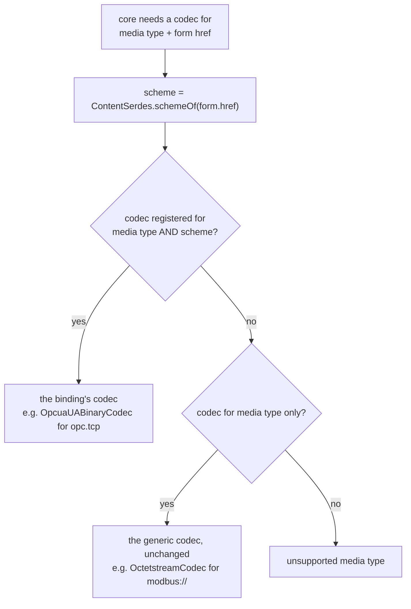
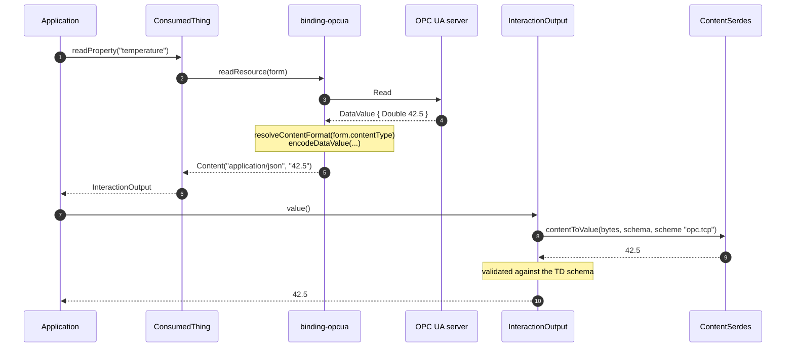
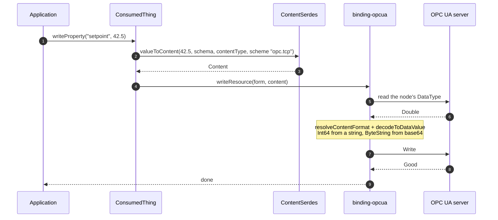
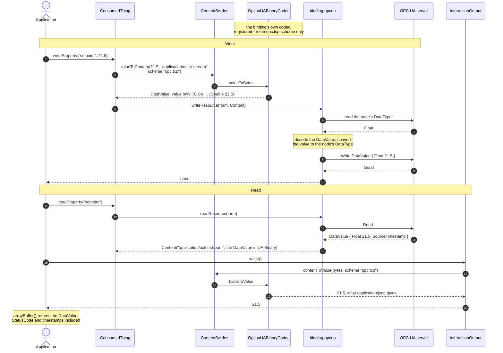
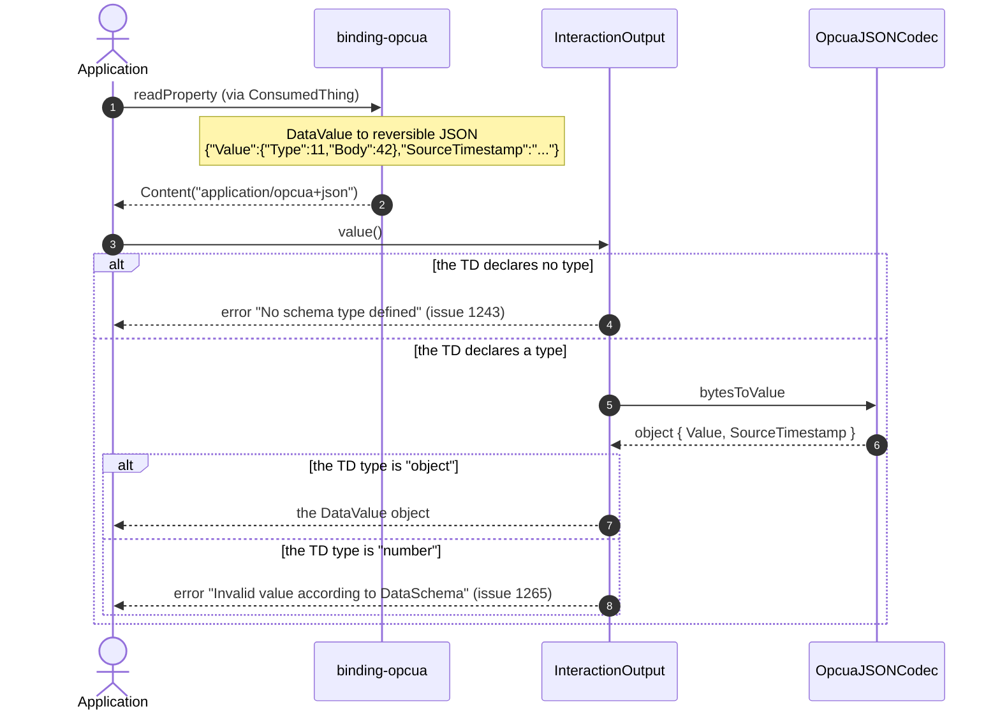

# Content negotiation

How a `contentType` on an OPC UA form decides what crosses the wire and what a WoT application
receives. Background: issue #1400, core issue #1409 and PR #1572.

## What each contentType means

| contentType                                                  | what the application sees                                                   | notes                                                            |
| ------------------------------------------------------------ | --------------------------------------------------------------------------- | ---------------------------------------------------------------- |
| omitted, i.e. `application/json`                             | the bare value: `42.5`, `"hello"`, `[1,2,3]`                                | the default fixed by W3C WoT TD 1.1 §5.3.4.2                     |
| `application/opcua+json;type=Value`                          | the bare value                                                              | same as above, stated explicitly                                 |
| `application/opcua+json;type=Variant`                        | value and OPC UA type: `{"Type":11,"Body":42.5}`                            | lossless, see [opcua-json-encoding.md](opcua-json-encoding.md)   |
| `application/opcua+json;type=DataValue` (the default `type`) | value, status code and timestamps                                           | lossless                                                         |
| `application/opcua+octet-stream`                             | OPC UA Binary; `value()` gives the whole DataValue as JSON                  | kept for backward compatibility                                  |
| `application/octet-stream`                                   | OPC UA Binary, the DataValue; `value()` gives what `application/json` gives | OPC 10101 §6.5.3, see [the plan](octet-stream-ua-binary-plan.md) |

Anything else is refused with an error naming the form, rather than handed to a codec that knows
nothing about OPC UA.

Every `application/opcua+json` form also takes `;version=1.04|1.05` (default `1.04`) and, for
1.05, `;mode=compact|verbose` (default `compact`). Writes accept either edition whatever the form
says. See [opcua-json-encoding.md](opcua-json-encoding.md).

## Payloads by example

The same three values, as they appear on the wire. This is also what a write must send, except for
the bare value, where the binding takes the type from the server.

**A ByteString** holding `DE AD BE EF`:

| contentType                                        | payload                                                                                         |
| -------------------------------------------------- | ----------------------------------------------------------------------------------------------- |
| `application/json`                                 | `"3q2+7w=="`                                                                                    |
| `application/opcua+json;type=Variant`              | `{"Type":15,"Body":"3q2+7w=="}`                                                                 |
| `application/opcua+json;type=Variant;version=1.05` | `{"UaType":15,"Value":"3q2+7w=="}`                                                              |
| `application/opcua+json;type=DataValue`            | `{"Value":{"Type":15,"Body":"3q2+7w=="},"SourceTimestamp":…}`                                   |
| `application/octet-stream`                         | the DataValue `05 0f 04 00 00 00 de ad be ef` + SourceTimestamp; `value()` reports `"3q2+7w=="` |

**An array of ByteStrings**, `[01 02]` and `[03]`:

| contentType                                        | payload                                                                                   |
| -------------------------------------------------- | ----------------------------------------------------------------------------------------- |
| `application/json`                                 | `["AQI=","Aw=="]` — reads fine, but writing it back stores the base64 text, not the bytes |
| `application/opcua+json;type=Variant`              | `{"Type":15,"Body":["AQI=","Aw=="]}` — round-trips                                        |
| `application/opcua+json;type=Variant;version=1.05` | `{"UaType":15,"Value":["AQI=","Aw=="]}`                                                   |
| `application/octet-stream`                         | the DataValue holding a ByteString array; `value()` reports `["AQI=","Aw=="]`             |

**An ExtensionObject** (an `Argument` structure):

| contentType                                        | payload                                                                                                                       |
| -------------------------------------------------- | ----------------------------------------------------------------------------------------------------------------------------- |
| `application/json`                                 | `{"Name":"Arg1","DataType":{"Id":6},"ValueRank":-1,…}` — the fields only, with no type identity                               |
| `application/opcua+json;type=Variant`              | `{"Type":22,"Body":{"TypeId":{"Id":296},"Body":{"Name":"Arg1",…}}}`                                                           |
| `application/opcua+json;type=Variant;version=1.05` | `{"UaType":22,"Value":{"UaTypeId":"i=296","UaBody":{"Name":"Arg1",…}}}`                                                       |
| `application/octet-stream`                         | the DataValue holding the ExtensionObject in UA Binary; `value()` as `application/json`; writing is refused for now (plan A3) |

Note what the structure's identity costs: the bare value has no `TypeId`, so the server cannot tell
which structure it is being handed. That is why writing a structure back currently fails, and why
the envelope forms are the ones to use for structures. 1.05 states the identity as a plain NodeId
string (`"i=296"`) instead of an object.

## Where each conversion happens

The binding owns the OPC UA side of both directions. Core owns the media-type side: it decodes
what a read returned, and encodes what a write sends. Since PR #1572 a binding can register a
codec for its own URI scheme, so `application/octet-stream` on an `opc.tcp://` form no longer
reaches the codec that packs Modbus registers:

```ts
// src/factory.ts
contentSerdes.addCodec(new OpcuaUABinaryCodec(), false, "opc.tcp");
```



## Read

The server supplies the type; the TD does not have to.



## Write

The binding asks the server for the node's DataType before building the Variant, so a TD that
says `"number"` still writes an Int32 to an Int32 node and an Int64 to an Int64 node.



## `application/octet-stream`

The payload is an OPC UA Binary DataValue. Core hands the value to the binding's own codec because
the form's scheme is `opc.tcp`; before PR #1572 it reached the codec that packs Modbus registers,
which is the whole of issue #1400. The codec runs in core, without a session: it encodes values of
built-in types, and hands anything else (a structure, an action input) to the binding as JSON. See
[octet-stream-ua-binary-plan.md](octet-stream-ua-binary-plan.md).



A structure from a companion specification can only be decoded with the server's
DataTypeDefinition. The binding then adds `;uaconn=<id>` to the Content type, never to the form,
and the codec decodes with the definitions of that session.

## What each OPC UA type does

Measured by reading a value, writing the same value back and comparing what the server holds
(`test/octet-stream-shapes-test.ts`, `test/contenttype-write-test.ts`). ✔ means the server ends up
with the value it started with.

`application/octet-stream` reads give what `application/json` gives, for every row
(`test/octet-stream-shapes-test.ts` asserts it). Its writes are measured for Double, Int32, Int64,
String, Boolean and ByteString; a structure is refused for now (plan question A3).

| OPC UA value                                                | `application/json` read            | write back, bare value                     | write back, `Variant` / `DataValue` |
| ----------------------------------------------------------- | ---------------------------------- | ------------------------------------------ | ----------------------------------- |
| Double, Int32, Float, Byte, Boolean, String, Guid, DateTime | the plain value                    | ✔                                         | ✔                                  |
| Int64, UInt64                                               | a string, as JSON cannot hold 2^53 | ✔                                         | ✔                                  |
| Enumeration                                                 | the number                         | ✔                                         | ✔                                  |
| ByteString                                                  | base64                             | ✔                                         | ✔                                  |
| arrays of the above                                         | a JSON array                       | ✔                                         | ✔                                  |
| ByteString[]                                                | array of base64                    | ✘ the base64 text is stored, not the bytes | ✔                                  |
| LocalizedText                                               | the text only                      | ✘ the locale is lost                       | ✔                                  |
| NodeId, QualifiedName                                       | an object                          | ✘ not converted back                       | ✔                                  |
| matrices (`Double[2][3]`)                                   | an envelope with `Dimensions`      | ✘                                          | ✔                                  |
| ExtensionObject, arrays and matrices of them                | the structure's fields             | ✘ a plain object is not an ExtensionObject | ✘ under investigation               |

These tests also print the whole matrix as a table, the quickest way to see what a change does to
every type at once. It is off by default so pipelines stay readable:

```sh
cd packages/binding-opcua && npm run test:verbose
```

Two conclusions worth keeping in mind:

-   **`opcua+json;type=Variant` and `type=DataValue` are the lossless forms.** Use them when a value
    must survive a round trip exactly.
-   **The bare value is lossy by construction for some types**, and several rows above are
    shortcomings of this binding rather than of OPC UA: most of them disappear with the 1.05
    encoding, which keeps the locale of a LocalizedText and writes a NodeId as a plain string. See
    [opcua-json-encoding.md](opcua-json-encoding.md).

## Things that are not this binding's to fix

-   **A read is validated against the TD schema by core**, after decoding. A TD that declares
    `"type": "number"` and asks for `type=DataValue` gets `Invalid value according to DataSchema`,
    because a DataValue is an object. A TD with no `type` gets `No schema type defined` before
    decoding even starts. See node-wot issues #1243 and #1265.

-   **`application/octet-stream` writes were impossible before PR #1572**, because core serializes a
    value before the binding is called.

The two schema errors in the first point happen in core, after the binding has done its part:


