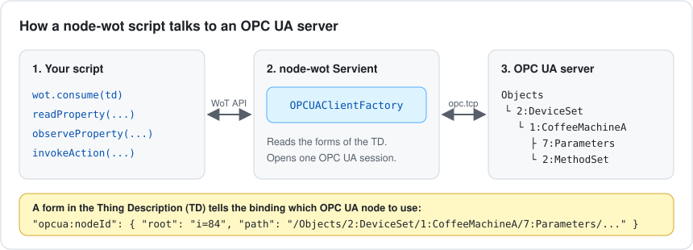
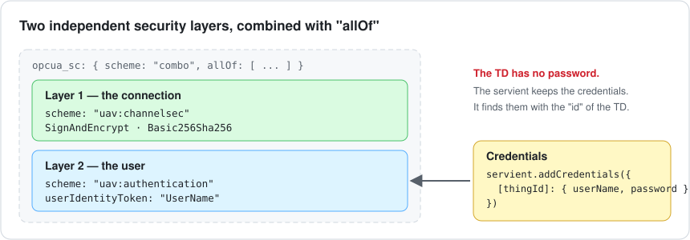
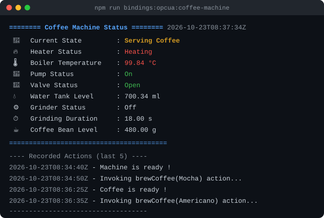

# OPC UA examples

These examples show how a node-wot script uses the OPC UA binding (`@node-wot/binding-opcua`).

Each example is a WoT client. It consumes a Thing Description (TD). Then it reads, monitors or controls an OPC UA server through the WoT API. The script does not use the OPC UA API directly.



## The examples

| Example                                                            | Command                                 | What it shows                                   | Server             |
| ------------------------------------------------------------------ | --------------------------------------- | ----------------------------------------------- | ------------------ |
| [1. Read a value](#example-1-read-a-value)                         | `npm run bindings:opcua:1`              | `readProperty`                                  | Public demo server |
| [2. Monitor a value](#example-2-monitor-a-value)                   | `npm run bindings:opcua:2`              | `observeProperty`                               | Public demo server |
| [3. Use a secure connection](#example-3-use-a-secure-connection)   | `npm run bindings:opcua:secure`         | Encryption, user name and password              | Local test server  |
| [4. Control a coffee machine](#example-4-control-a-coffee-machine) | `npm run bindings:opcua:coffee-machine` | `observeProperty`, `invokeAction`, browse paths | Public demo server |

The folder contains these files:

| File                                                                                     | Contents                                         |
| ---------------------------------------------------------------------------------------- | ------------------------------------------------ |
| [`demo-opcua1.ts`](demo-opcua1.ts)                                                       | Example 1.                                       |
| [`demo-opcua2.ts`](demo-opcua2.ts)                                                       | Example 2.                                       |
| [`demo-opcua-thing-description.ts`](demo-opcua-thing-description.ts)                     | The TD for examples 1 and 2. It is not a script. |
| [`demo-opcua-secure.ts`](demo-opcua-secure.ts)                                           | Example 3. The TD is in the same file.           |
| [`opcua-coffee-machine-demo.ts`](opcua-coffee-machine-demo.ts)                           | Example 4.                                       |
| [`opcua-coffee-machine-thing-description.ts`](opcua-coffee-machine-thing-description.ts) | The TD for example 4. It is not a script.        |

## Before you start

1. Go to the root folder of the node-wot repository.
2. Install the dependencies:

    ```sh
    npm install
    ```

3. Build all the packages. The examples run from the compiled files in `packages/examples/dist`.

    ```sh
    npm run build
    ```

4. Go to the examples package. Run all the commands in this README from this folder.

    ```sh
    cd packages/examples
    ```

Examples 1, 2 and 4 connect to the public demo server `opc.tcp://opcuademo.sterfive.com:26543`. Make sure that your network lets outgoing TCP connections go to port 26543.

## Example 1: read a value

File: [`demo-opcua1.ts`](demo-opcua1.ts)

This example shows the minimum code for an OPC UA client. The script does these steps:

1. It makes a `Servient` and adds an `OPCUAClientFactory` to it.
2. It consumes the TD from [`demo-opcua-thing-description.ts`](demo-opcua-thing-description.ts).
3. It reads the `pumpSpeed` property one time.
4. It shows the value and stops the servient.

Run the example:

```sh
npm run bindings:opcua:1
```

The output is similar to this:

```text
------------------------------
Pump Speed is :  226.74254433039275 m/s
------------------------------
```

In this TD, the form gives the OPC UA node ID in the `href`:

```js
forms: [{ href: "?id=ns=1;s=PumpSpeed", op: ["readproperty", "observeproperty"] }];
```

`ns=1;s=PumpSpeed` is the OPC UA node ID. `ns=1` is the index of a namespace on this server. `s=PumpSpeed` is the identifier of the node in that namespace. To use this form, you must know the node ID. Example 4 shows a different method: a browse path.

## Example 2: monitor a value

File: [`demo-opcua2.ts`](demo-opcua2.ts)

This example uses the same TD as example 1. It calls `observeProperty` on the `temperature` property. The binding makes an OPC UA subscription. The server then sends each new value to the script. The script stops after 10 seconds.

Run the example:

```sh
npm run bindings:opcua:2
```

The output is similar to this. You get one block for each change of the value:

```text
------------------------------
temperature :  27.857900469092474 °C
------------------------------
------------------------------
temperature :  27.701475748181856 °C
------------------------------
```

## Example 3: use a secure connection

File: [`demo-opcua-secure.ts`](demo-opcua-secure.ts)

This example connects to a server that requires a secure connection. It reads one property. The security agrees with OPC 10101 (OPC UA Binding for WoT), section 6.3.3.



The TD has two independent security layers:

-   **Layer 1, the connection** (`uav:channelsec`). The client signs and encrypts all the messages. It uses the `Basic256Sha256` security policy.
-   **Layer 2, the user** (`uav:authentication`). The client identifies itself with a user name and a password.

The `combo` scheme with `allOf` tells the binding to apply the two layers together.

The TD does not contain the password. The script gives the credentials to the servient with `servient.addCredentials()`. The servient finds them with the `id` of the TD. Thus, the TD must have an `id`.

> [!IMPORTANT]
> Do not write passwords in a TD. In a real application, get the credentials from a secret store or from the operator.

This example uses the test server of the OPC UA binding. You must start it first.

1. Open a terminal. Start the test server and keep it open:

    ```sh
    npx ts-node ../binding-opcua/test/fixture/basic-opcua-server.ts
    ```

2. Open a second terminal. Run the example:

    ```sh
    npm run bindings:opcua:secure
    ```

3. Stop the test server with <kbd>Ctrl</kbd>+<kbd>C</kbd>.

The output is similar to this:

```text
------------------------------
temperature is : 25 °C
------------------------------
```

If the user name or the password is not correct, the script stops with an error. The binding does not change to an anonymous connection without encryption.

## Example 4: control a coffee machine

Files: [`opcua-coffee-machine-demo.ts`](opcua-coffee-machine-demo.ts) and [`opcua-coffee-machine-thing-description.ts`](opcua-coffee-machine-thing-description.ts)

This example controls a simulated coffee machine on the public demo server. It shows a full application:

1. It monitors 9 properties of the machine, for example the boiler temperature and the water tank level.
2. It shows the values in a status screen. The screen changes when a value changes.
3. It waits until the machine is in the `Standby` state.
4. It makes a Mocha, then an Americano, with the `brewCoffee` action.
5. It fills the water tank with the `fillTank` action.

Run the example:

```sh
npm run bindings:opcua:coffee-machine
```

The script runs for approximately 5 minutes. It stops when the machine has filled the tank. The status screen is similar to this:



### Identify a node with a browse path

The forms of this TD do not give a node ID. Each form gives a browse path from a known root node:

```js
"opcua:nodeId": {
    root: "i=84", // the Root folder, the same on all OPC UA servers
    path: "/Objects/2:DeviceSet/1:CoffeeMachineA/7:Parameters/17:WaterTankLevel",
}
```

The binding asks the server to find the node at the end of the path (the OPC UA `TranslateBrowsePathsToNodeIds` service). Thus, you do not have to know the node ID. You only have to know the names of the nodes, as an OPC UA browser shows them.

Each name in the path has the form `index:name`. The `index` is the namespace index of the name on this server. The `@context` of the TD gives the namespace URI of each index:

```js
"@context": [
    "https://www.w3.org/2019/wot/td/v1",
    {
        "2": "http://opcfoundation.org/UA/DI/",
        "7": "http://opcfoundation.org/UA/CommercialKitchenEquipment/",
        "17": "http://sterfive.com/UA/CoffeeMachine/",
    },
],
```

> [!NOTE]
> The binding uses the numbers as they are. It does not use the `@context` to find the index of a URI. If the server changes its namespace indexes, you must change the paths in the TD.

### Call an OPC UA method

An action form has two parts:

-   `opcua:nodeId` identifies the object that owns the method. Here it is `2:MethodSet`.
-   `opcua:method` identifies the method. Here it is `17:MakeCoffee`.

```js
"opcua:nodeId": { root: "i=84", path: "/Objects/2:DeviceSet/1:CoffeeMachineA/2:MethodSet" },
"opcua:method": { root: "i=84", path: "/Objects/2:DeviceSet/1:CoffeeMachineA/2:MethodSet/17:MakeCoffee" },
```

> [!CAUTION]
> The `opcua:nodeId` must identify the object that has the method as a component. Here, this object is `2:MethodSet`, not `1:CoffeeMachineA`. If you use the wrong object, the server refuses the call with `BadMethodInvalid (0x80750000)`.

The input of `brewCoffee` is an object. The script sends `{ RecipeName: "Mocha" }`. The binding gives this value to the input argument of the OPC UA method that has the same name.

## Write your own client

All the examples use the same structure. Use it as a start for your own script:

```typescript
import { Servient } from "@node-wot/core";
import { OPCUAClientFactory } from "@node-wot/binding-opcua";

const servient = new Servient();
servient.addClientFactory(new OPCUAClientFactory());

const wot = await servient.start();
const thing = await wot.consume(thingDescription);

// Use the thing with the WoT API
const value = await (await thing.readProperty("temperature")).value();
await thing.observeProperty("temperature", async (data) => console.log(await data.value()));
await thing.invokeAction("brewCoffee", { RecipeName: "Mocha" });

// Close the OPC UA connections
await servient.shutdown();
```

Always call `servient.shutdown()` at the end. It closes the OPC UA sessions and connections.

## Troubleshooting

| Problem                                                  | Possible cause and remedy                                                                                              |
| -------------------------------------------------------- | ---------------------------------------------------------------------------------------------------------------------- |
| `Cannot find module '.../dist/bindings/opcua/...'`       | The examples are not compiled. Do `npm run build` in the root folder.                                                  |
| The script does not connect to `opcuademo.sterfive.com`. | Your network blocks port 26543. Use a different network, or use a local server.                                        |
| `BadMethodInvalid (0x80750000)` when you call an action. | `opcua:nodeId` does not identify the object that owns the method. See [Call an OPC UA method](#call-an-opc-ua-method). |
| Example 3 stops with `failed:`.                          | The test server does not run, or the credentials are not correct. Start the server first.                              |

## More information

-   [The OPC UA binding package](../../../../binding-opcua/README.md)
-   [OPC 10101: OPC UA Binding for WoT](https://reference.opcfoundation.org/specs/OPC-10101)
-   [W3C WoT Thing Description](https://www.w3.org/TR/wot-thing-description11/)
